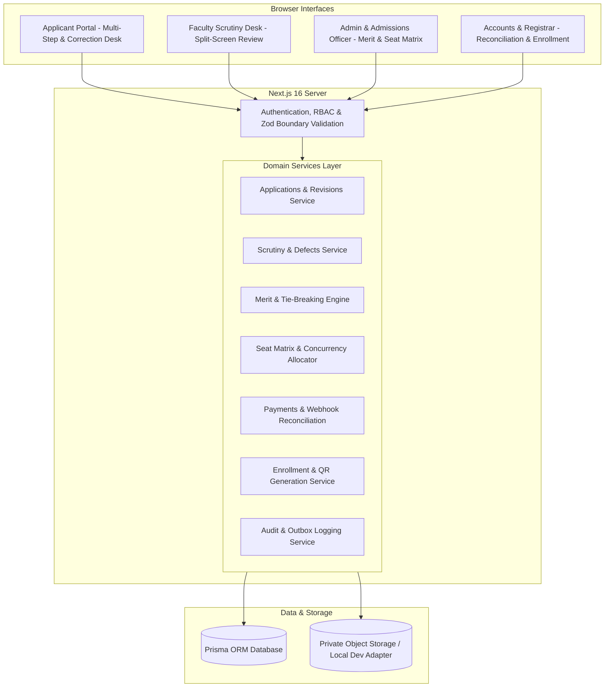

# Architecture & Module Specifications

## 1. System Overview
The Admission Portal is built as an enterprise-grade modular monolith supporting the complete student admissions lifecycle.

## 2. Layering Rules
- **UI Components (`src/components/`, `src/app/`)**: Pure presentation, zero direct database access.
- **Server Actions & Route Handlers (`src/app/api/`)**: Authentication, permission checks, request parsing via Zod, delegating immediately to Domain Services.
- **Domain Services (`src/server/modules/`)**: Encapsulates all business rules, optimistic concurrency, and state transitions.
- **Data Access (`src/server/db/`)**: Prisma Client instance, transactional helpers.
- **Integrations (`src/server/integrations/`)**: Storage adapters, Mock/Razorpay payment gateway, email outbox.
