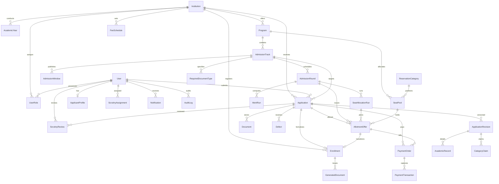

# Canonical Data Model & Relational Specifications

## 1. Entity Relational Diagram (ERD)

## 2. Integrity & Database Constraints
1. **Seat Invariant**: Every `SeatPool` row strictly enforces `0 <= heldCount + confirmedCount <= capacity`.
2. **Deterministic Tie-Breaking**: `(meritRunId, applicationId)` unique constraint prevents duplicate rankings.
3. **Optimistic Locking**: `version` counter on `Application`, `SeatPool`, and `AllotmentOffer` prevents concurrent overwrite conflicts.
4. **Idempotent Enrollment**: `(applicationId)` and `(offerId)` are strictly unique on `Enrollment`. Repeated enrollment calls return the existing record.
5. **Private Storage**: Storage keys are randomized SHA-256 hashes stored in private directories; never exposed via unauthenticated public routes.
